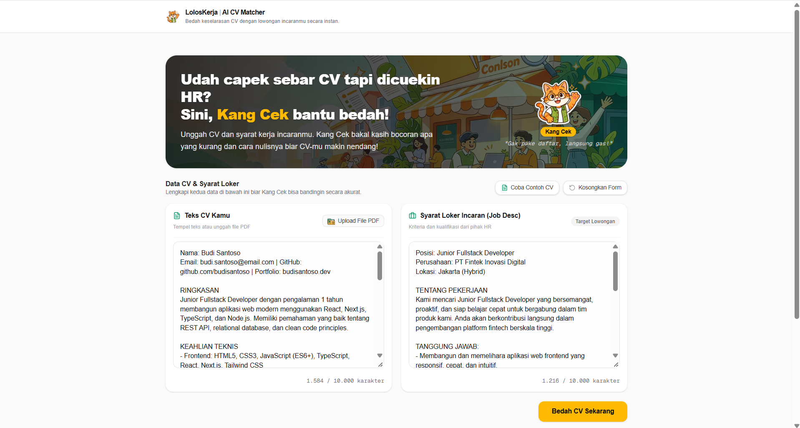
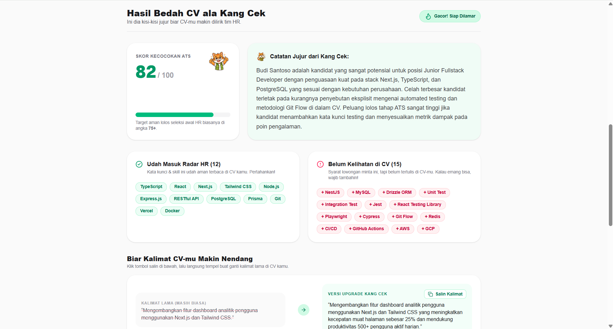

# 🐱 LolosKerja | Bedah CV Bareng Kang Cek

[](https://nextjs.org/)
[](https://www.typescriptlang.org/)
[](https://tailwindcss.com/)
[](https://sdk.vercel.ai/)
[](https://ai.google.dev/)

**LolosKerja** adalah aplikasi web utilitas berbasis AI yang membantu pencari kerja mengevaluasi kesesuaian CV terhadap deskripsi lowongan kerja (*Job Description*) secara objektif. 

Berbeda dengan *chatbot* AI generik yang hanya mengembalikan paragraf teks panjang, LolosKerja membedah CV menjadi laporan audit terstruktur, lengkap dengan skor kecocokan ATS, matriks pemetaan *skill*, serta rekomendasi penulisan ulang poin pengalaman yang siap salin, dibalut dengan antarmuka ramah pengguna dan *microcopy* khas Indonesia bersama maskot **Kang Cek**.

🔗 **Live Demo:** `loloskerja-ai-cv-matcher.vercel.app`

---
<p align="center">
  
  
</p>

## Fitur Utama

* **Ekstraksi PDF Langsung di Browser (*Client-Side*):** Mendukung unggah file CV berformat `.pdf` menggunakan `pdfjs-dist` dengan *dynamic import* sehingga pemrosesan teks terjadi 100% di perangkat pengguna tanpa membebani memori server, lengkap dengan deteksi otomatis untuk menolak PDF hasil *scan* gambar.
* **Skor Kecocokan ATS & Evaluasi Objektif:** Menghitung persentase kecocokan (`0–100%`) berdasarkan kualifikasi wajib lowongan beserta ringkasan evaluasi realistis.
* **Matriks Kata Kunci (*Keyword Gap Analysis*):** Memisahkan kualifikasi teknis dan nonteknis menjadi dua kelompok visual: kata kunci yang sudah terbaca di CV (*Matched Skills*) dan kata kunci penting yang belum tercantum (*Missing Skills*).
* **Perombak Kalimat Pengalaman (*Bullet Point Rewriter*):** Mengubah kalimat pengalaman kerja yang pasif menjadi kalimat berorientasi dampak dan metrik dalam tampilan perbandingan **Sebelum vs. Sesudah**, dilengkapi tombol **Salin Kalimat** 1-klik.
* **Riwayat Analisis Lokal (*Zero-Login*):** Menyimpan hingga 5 hasil analisis terakhir secara otomatis di `localStorage` browser pengguna sehingga riwayat tetap terjaga tanpa perlu sistem autentikasi maupun database eksternal.
* **Demo Instan 1-Klik (*Sample Data*):** Menyediakan tombol pengisi data simulasi CV dan *Job Description* agar penguji atau rekruter dapat langsung mencoba alur kerja aplikasi dalam hitungan detik.

---

## Keputusan Rekayasa & Arsitektur Teknis

Aplikasi ini dirancang dengan fokus pada keandalan produksi (*production-grade reliability*), keamanan kredensial, dan kecepatan respons:

### 1. Enforced Structured Output (Zod + Vercel AI SDK)
Banyak aplikasi AI pemula rentan mengalami *UI crash* karena format respons teks dari LLM yang tidak konsisten. Untuk mengatasi hal ini, LolosKerja menerapkan kontrak skema data ketat menggunakan **Zod** (`src/lib/schema.ts`) yang diintegrasikan dengan fungsi `generateObject` dari **Vercel AI SDK**. 
* Model AI dipaksa mengembalikan objek JSON yang valid dan *type-safe* (mencakup tipe angka untuk skor, array string untuk *skill*, dan array objek tervalidasi untuk saran perbaikan).
* Deskripsi eksplisit (`.describe()`) pada setiap properti Zod memastikan kelengkapan dan kedalaman output tetap terjaga di setiap permintaan.

### 2. Multi-Model Fallback & Latency Optimization (200+ Detik → ~10 Detik)
Pada tahap pengujian awal, penggunaan model utama berkapasitas besar dengan *reasoning/thinking mode* aktif dan *default retry* memicu antrean server (`503 High Demand`) yang memperpanjang waktu tunggu hingga lebih dari **3 menit (200+ detik)**—yang berisiko menyebabkan *error* `504 Gateway Timeout` pada lingkungan *serverless*.

Masalah latensi ini diselesaikan melalui tiga langkah optimasi arsitektur di `src/app/api/analyze/route.ts`:
* **Penentuan Model Utama Ringan:** Menggunakan **`gemini-3.5-flash-lite`** sebagai model primer karena memiliki latensi rendah dan stabilitas tinggi untuk ekstraksi JSON terstruktur.
* **Pembatasan Timeout & Retry Eksplisit:** Menonaktifkan pengulangan otomatis tersembunyi (`maxRetries: 0`) dan memasang `AbortSignal.timeout(15000)` agar permintaan yang macet tidak menggantung tanpa batas.
* **Automatic Model Fallback:** Jika model primer mengalami gangguan atau *timeout*, server secara otomatis mengalihkan permintaan ke **`gemini-3.8-flash`** sebagai model cadangan, dengan batas eksekusi *serverless* yang dikonfigurasi melalui `export const maxDuration = 30`.

### 3. Server-Side Security & Zero-Friction Demo
* **Isolasi API Key di Server:** Seluruh komunikasi dengan Google Gemini API dieksekusi secara eksklusif di dalam Next.js Route Handler (`/api/analyze`) menggunakan `createGoogleGenerativeAI`. Kunci `GEMINI_API_KEY` tidak pernah terekspos ke sisi klien (`NEXT_PUBLIC_`) maupun disimpan di dalam kode sumber.
* **Validasi Input & Privasi:** Endpoint server memvalidasi batas maksimal 10.000 karakter per input untuk mencegah penyalahgunaan kuota API, serta menerapkan prinsip *zero-storage* di sisi server (data CV pengguna tidak disimpan di database mana pun).
* **Zero-Friction Demo:** Pengunjung dapat langsung menguji seluruh siklus aplikasi—mulai dari status *loading* interaktif hingga hasil audit—cukup dengan satu klik melalui tombol **Isi Contoh Data**.

---

## Tech Stack

| Kategori | Teknologi | Peran dalam Sistem |
| :--- | :--- | :--- |
| **Framework** | Next.js (App Router) | Rendering antarmuka dan API Route Handler sisi server |
| **Bahasa** | TypeScript | Menjamin keamanan tipe data (*end-to-end type safety*) |
| **AI Orchestration** | Vercel AI SDK (`ai`, `@ai-sdk/google`) | Penghubung model Gemini dengan validasi output terstruktur |
| **Model AI** | Gemini 3.5 Flash Lite & Gemini 3.8 Flash | Mesin pemrosesan bahasa alami dan audit kecocokan CV |
| **Validasi Skema** | Zod | Kontrak skema JSON antara respons AI dan komponen UI |
| **PDF Parser** | `pdfjs-dist` | Ekstraksi teks dokumen PDF langsung di sisi browser |
| **Styling & Ikon** | Tailwind CSS & Lucide React | Desain responsif, animasi CSS ringan, dan ikonografi UI |
| **Deployment** | Vercel | Hosting *serverless* dengan dukungan *environment variables* |

---

## Struktur Folder

```text
ai-cv-matcher/
├── public/
│   └── mascots/                # Aset ilustrasi PNG transparan maskot Kang Cek
├── src/
│   ├── app/
│   │   ├── api/
│   │   │   └── analyze/
│   │   │       └── route.ts    # Endpoint server Gemini API, timeout & fallback logic
│   │   ├── globals.css         # Konfigurasi Tailwind CSS & custom keyframes animasi
│   │   ├── layout.tsx          # Root layout dan metadata halaman
│   │   └── page.tsx            # Halaman utama & manajemen state aplikasi
│   ├── components/
│   │   ├── AnalyzingState.tsx  # Layar tunggu interaktif dengan status dinamis
│   │   ├── Footer.tsx          # Tips kilat rekrutmen, kredit pembuat & tautan sosial
│   │   ├── HistoryBar.tsx      # Bilah riwayat 5 analisis terakhir dari localStorage
│   │   ├── InputSection.tsx    # Form dual-input, dropzone PDF & tombol sample data
│   │   ├── MascotImage.tsx     # Pembungkus gambar dengan fallback otomatis
│   │   └── ResultDashboard.tsx # Visualisasi skor ATS, skill matrix & rewriter cards
│   └── lib/
│       ├── history.ts          # Helper CRUD localStorage aman SSR
│       ├── pdf-parser.ts       # Ekstraktor teks PDF browser dengan dynamic import
│       ├── sample-data.ts      # Data simulasi CV & Job Desc untuk demo 1-klik
│       └── schema.ts           # Skema Zod (Single Source of Truth)
├── .env.example                # Contoh format variabel lingkungan
├── .gitignore                  # Memblokir .env.local dan node_modules dari Git
└── package.json
```
## Cara Menjalankan di Lokal
**Prasyarat**
- Node.js versi 18.18 atau lebih baru
- Kunci API gratis dari Google AI Studio

**Langkah Instalasi**
1. Clone repositori ini:
```bash
git clone https://github.com/azmilramadhan/ai-cv-matcher.git
cd ai-cv-matcher
```
2. Instal seluruh dependensi:
```bash
npm install
```
3. Konfigurasi Environment Variable:
Salin file .env.example menjadi .env.local:
```bash
cp .env.example .env.local
```
Buka file .env.local dan masukkan kunci API Gemini Anda:
```bash
GEMINI_API_KEY=AIzaSy_masukkan_api_key_asli_anda_di_sini
```
4. Jalankan server pengembangan:
```bash
npm run dev
```
Buka http://localhost:3000 di browser Anda.
## Disclaimer
***Hasil skor kecocokan, analisis kata kunci, dan saran perbaikan kalimat yang dihasilkan oleh LolosKerja merupakan simulasi berbasis kecerdasan buatan yang ditujukan sebagai panduan persiapan lamaran kerja. Keputusan seleksi akhir tetap bergantung sepenuhnya pada kebijakan masing-masing perusahaan dan tim rekrutmen.***